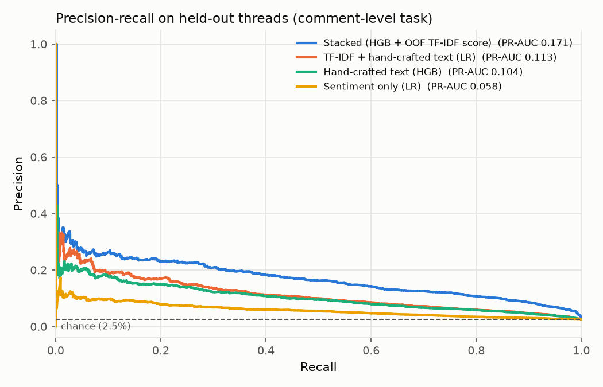
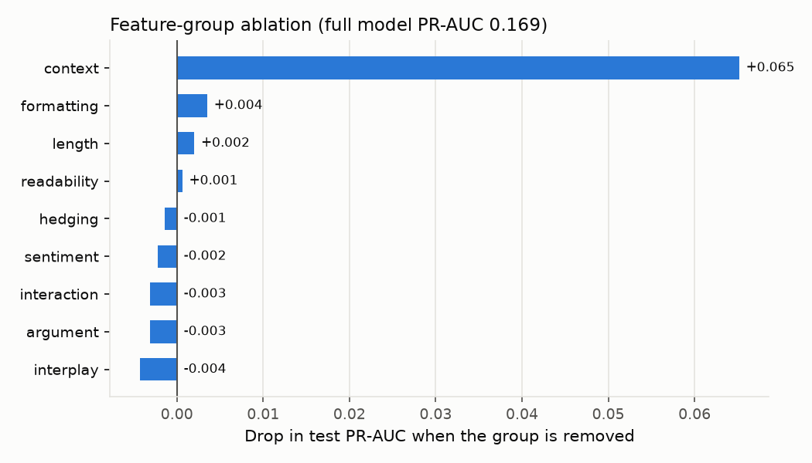

# Persuasion Scorer: What Makes an Argument Actually Change Minds?

A machine learning system that predicts argument persuasiveness — not sentiment, not toxicity, but actual mind-changing power — trained on real outcomes from Reddit's r/changemyview.

## The Problem

Most NLP projects classify *tone* (positive/negative, toxic/civil). Almost none tackle *persuasion* directly, because it's genuinely harder: a persuasive argument can be blunt, polite, short, or long — the signal isn't in surface sentiment at all. This project asks a more interesting question: **what linguistic and structural features actually correlate with changing someone's mind?**

## The Approach

Using the Change My View subreddit as a natural experiment — where the original poster (OP) awards a "Δ" (delta) when a reply changes their view — this project predicts whether a reply will be persuasive from interpretable linguistic, argumentative, and conversational features, and compares them against bag-of-words and gradient-boosted models.

### Labels: comment-level deltas from DeltaBot

The ConvoKit `winning-args-corpus` marks `success` at the **thread** level (it comes from the paired design of Tan et al., 2016), and sets it on every comment in a successful thread, *including the OP's own replies*. Treating it as a per-comment label makes comments like "∆ Enjoy your delta" count as persuasive.

Instead, labels are derived from DeltaBot's confirmations (`OP awards ∆ → DeltaBot: "Confirmed: 1 delta awarded to /u/X"`): a comment is persuasive only if the OP awarded it a confirmed delta. The pipeline also:
- keeps only **challenger** comments (drops the OP, DeltaBot, AutoModerator, and deleted comments)
- strips lines mentioning a delta (e.g. "EDIT: thanks for the ∆!"), which winners add *after* winning
- HTML-unescapes text (Reddit stores `>` quotes as `&gt;`)

Result: 218,290 challenger comments across 3,046 threads, 2.0% persuasive.

### Features (in named groups, for ablation)

| Group | Examples |
|---|---|
| length | log word count, sentences, sentence length, paragraphs |
| readability | Flesch reading ease, word length, type–token ratio |
| hedging | hedges ("might", "I think") vs. certainty ("clearly", "of course"), per 100 words |
| argument | evidence markers, examples, counterargument acknowledgment, contrast, links, quoting |
| interaction | first-person singular/plural, second person, questions |
| formatting | list items, emphasis, numbers |
| sentiment | VADER compound / positive / negative / intensity |
| interplay | overlap with the OP: content-word and stopword Jaccard, OP coverage, novelty |
| context | depth, whether it replies to the OP, entry order, time since the thread opened |

Lexicon features are matched on word boundaries and normalized per 100 words, so they don't just proxy length. Context features describe *where* a comment was posted, not what it says, so they're kept out of the deployable text scorer.

### Evaluation

- **Thread-level split.** The corpus' official train/test split is by thread, so no thread appears in both. A random row split would leak each thread's OP and topic vocabulary across the boundary.
- **Thresholds tuned out-of-fold** (5-fold `GroupKFold` over training threads), never on the test set.
- **95% bootstrap CIs**, resampling whole threads.
- **Two tasks.** *(A)* Comment-level: will this comment earn a delta? *(B)* Paired root replies (Tan et al., 2016): for two replies to the same post, one of which started a successful discussion, does the model rank the winner higher? Task B controls for topic and OP, so it isolates the argument itself.

## Results

### Task A — comment-level delta prediction (38,181 test comments, 2.5% persuasive)

| Model | PR-AUC [95% CI] | ROC-AUC | Precision @ top 1% | F1 (OOF threshold) |
|---|---|---|---|---|
| **Stacked: HGB on all features + out-of-fold TF-IDF score** | **0.171** [0.155, 0.193] | 0.899 | 0.26 | 0.25 |
| All features incl. context (HGB) | 0.169 [0.153, 0.190] | 0.898 | 0.26 | 0.25 |
| TF-IDF + hand-crafted text (LR) — *deployed scorer* | 0.114 [0.101, 0.131] | 0.817 | 0.20 | 0.19 |
| Hand-crafted text (LR) | 0.108 [0.095, 0.126] | 0.807 | 0.21 | 0.17 |
| Hand-crafted text (HGB) | 0.104 [0.093, 0.120] | 0.810 | 0.18 | 0.17 |
| TF-IDF only (LR) | 0.100 [0.089, 0.114] | 0.800 | 0.18 | 0.17 |
| Sentiment only (LR) | 0.058 [0.051, 0.068] | 0.694 | 0.10 | 0.11 |

Full tables, including precision/recall at the tuned threshold, are in [`reports/results/`](reports/results/).

Chance PR-AUC is 0.025. Among the 1% of comments the best model is most confident about, 26% earned a delta, about 10× the base rate.



### Task B — paired root replies (777 test pairs, chance = 50%)

| Model | Pairwise accuracy [95% CI] |
|---|---|
| **TF-IDF + hand-crafted text (LR)** | **65.5%** [62.3, 68.5] |
| All features incl. context (HGB) | 65.3% [61.9, 68.0] |
| Hand-crafted text (LR) | 63.8% [60.7, 67.2] |
| Interplay with OP only (LR) | 63.5% [60.0, 66.9] |
| Sentiment only (LR) | 53.7% [50.3, 57.1] |

### Feature-group ablation (Task A, HGB)



### Takeaways

**1. Fixing the labels changed the story.** An earlier version of this project used the thread-level `success` flag as a comment label and a random row split, and reported TF-IDF PR-AUC 0.25. About half of those "persuasive" examples were the OP's own replies, often containing "∆" or "thanks, you changed my view". The bag-of-words model was largely detecting delta *awards*, not persuasive arguments. On clean labels, vocabulary alone is a modest signal (0.100), roughly on par with the hand-crafted features (0.108).

**2. Persuasion is distinct from sentiment.** This was the project's open question. Tone alone barely beats a coin flip at picking the winner of a matched pair (53.7%, CI touching 50%), while the text model reaches 65.5%. Adding sentiment to the full model doesn't help either (dropping it changes PR-AUC by less than the noise).

**3. Being in a dialogue with the OP matters most.** Removing the context group drops PR-AUC from 0.169 to 0.104, the only ablation well outside the noise (individual text groups move it by ±0.004 because they overlap heavily). The main driver is whether a comment replies to the OP directly: deltas go to people engaging the OP, not to side arguments with other commenters. This is a property of the conversation, not the prose.

**4. Among text features, effort and engagement with the OP's words stand out.** Standardized coefficients from the hand-crafted LR ([`reports/results/feature_coefficients.csv`](reports/results/feature_coefficients.csv)) show:
- Length is by far the largest (+1.46 for log word count). Longer, more developed replies win.
- Reusing the OP's *content* words helps (+0.31), while introducing lots of novel vocabulary hurts (−0.17). Persuasive replies argue on the OP's terms.
- Certainty markers hurt (−0.18), and hedges help slightly (+0.07). Sounding sure of yourself doesn't change minds.
- Addressing the reader ("you", +0.18) helps. Heavy quoting of the OP is mildly negative (−0.10).
- Readability (+0.03) and explicit counterargument phrases (−0.07) are near zero once length is controlled for. An earlier finding that "readability beats sophistication" did not survive the label fix.

These are associations from a linear model over correlated features, not causal effects.

**5. Matched-pair accuracy of ~65%** on Tan et al.'s root-reply task, using interpretable features plus TF-IDF. Interplay with the OP alone gets 63.5%.

## Scoring your own argument

```bash
python src/predict.py \
  --op "CMV: Public transit should be free. Fares are a regressive tax on poor riders." \
  --reply "I see where you're coming from, but consider what happened in cities that tried it..."
```

```
Score: 0.713   (decision threshold 0.808) -> unlikely to persuade

Features pushing the score up:
  +1.002  op_jaccard_content
  +0.367  log_word_count
  +0.148  example_rate
Features pushing the score down:
  -0.175  op_jaccard_stop
  -0.101  type_token_ratio
Words/phrases pushing up:
  +0.072  drivers
  +0.065  the system
...
```

The score comes from a class-balanced model, so treat it as a ranking signal rather than a calibrated probability.

## Tech Stack

- `ConvoKit` (Cornell Conversational Analysis Toolkit) — dataset
- `scikit-learn` — logistic regression, histogram gradient boosting, grouped CV
- `pandas` / `numpy` / `pyarrow` — data handling
- `textstat`, `vaderSentiment` — readability and sentiment features
- `matplotlib` — figures; `pytest` — tests

## Project Structure

```
cmv-persuasion-scorer/
├── data/                 # processed data (gitignored)
├── models/               # trained model artifacts (gitignored)
├── reports/
│   ├── figures/          # PR curves, ablation chart
│   └── results/          # metrics, ablation, and coefficient tables (CSV)
├── src/
│   ├── data_loader.py    # corpus → challenger comments with DeltaBot-derived labels
│   ├── features.py       # grouped feature extraction (parallel)
│   ├── train.py          # both tasks, CV, stacking, bootstrap CIs, ablation, figures
│   └── predict.py        # score and explain a single reply
├── tests/                # pytest unit tests for features, labels, and metrics
├── requirements.txt
└── README.md
```

## Setup & Usage

```bash
git clone https://github.com/<your-username>/cmv-persuasion-scorer.git
cd cmv-persuasion-scorer
pip install -r requirements.txt

python src/data_loader.py   # ~1 min:  download corpus, build labeled comments
python src/features.py      # ~2 min:  extract features (uses all CPU cores)
python src/train.py         # ~15 min: train/evaluate both tasks, ablation, figures
python src/predict.py --op "..." --reply "..."
pytest tests
```

`train.py` options: `--folds`, `--bootstrap`, `--skip-ablation`, and `--figures-only` (redraw figures from saved predictions).

## References

Tan, C., Niculae, V., Danescu-Niculescu-Mizil, C., & Lee, L. (2016). *Winning Arguments: Interaction Dynamics and Persuasion Strategies in Good-faith Online Discussions.* WWW 2016.

## License

MIT
