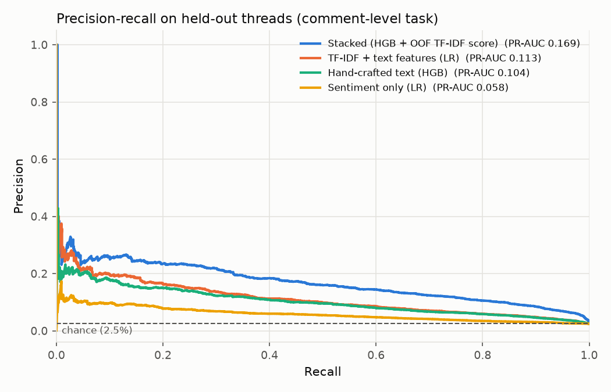
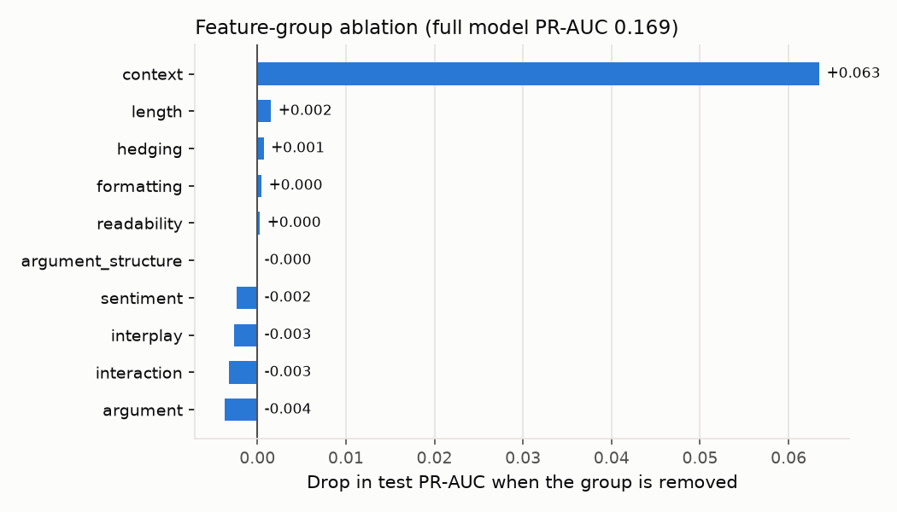

# Persuasion Scorer: What Makes an Argument Actually Change Minds?

A machine learning system that predicts argument persuasiveness — not sentiment, not toxicity, but actual mind-changing power — trained on real outcomes from Reddit's r/changemyview.

## The Problem

Most NLP projects classify *tone* (positive/negative, toxic/civil). Almost none tackle *persuasion* directly, because it's genuinely harder: a persuasive argument can be blunt, polite, short, or long — the signal isn't in surface sentiment at all. This project asks a more interesting question: **what linguistic and structural features actually correlate with changing someone's mind?**

## The Approach

Using the Change My View subreddit as a natural experiment — where the original poster (OP) awards a "Δ" (delta) when a reply changes their view — this project predicts whether a reply will be persuasive from interpretable linguistic, argumentative, and conversational features, and compares them against bag-of-words and gradient-boosted models.

### Labels: comment-level deltas from DeltaBot

The ConvoKit `winning-args-corpus` marks `success` at the **thread** level (it comes from the paired design of Tan et al., 2016), and sets it on every comment in a successful thread, *including the OP's own replies*. Treating it as a per-comment label makes comments like "∆ Enjoy your delta" count as persuasive.

Instead, labels are derived from DeltaBot's confirmations (`OP awards ∆ → DeltaBot: "Confirmed: 1 delta awarded to /u/X"`): a comment is persuasive only if the OP awarded it a confirmed delta. The pipeline also:
- keeps only **challenger** comments (drops the OP, DeltaBot, AutoModerator, and deleted comments)
- strips lines mentioning a delta (e.g. "EDIT: thanks for the ∆!"), which winners add *after* winning
- HTML-unescapes text (Reddit stores `>` quotes as `&gt;`)

Result: 218,290 challenger comments across 3,046 threads, 2.0% persuasive.

### Features (in named groups, for ablation)

| Group | Examples |
|---|---|
| length | log word count, sentences, sentence length, paragraphs |
| readability | Flesch reading ease, word length, type–token ratio |
| hedging | hedges ("might", "I think") vs. certainty ("clearly", "of course"), per 100 words |
| argument | evidence markers, examples, counterargument acknowledgment, contrast, links, quoting |
| interaction | first-person singular/plural, second person, questions |
| formatting | list items, emphasis, numbers |
| sentiment | VADER compound / positive / negative / intensity |
| interplay | overlap with the OP: content-word and stopword Jaccard, OP coverage, novelty |
| argument_structure | predicted discourse roles (claim / evidence / counterclaim / rebuttal) and expert-style effectiveness of each chunk, transferred from PERSUADE (below) |
| context | depth, whether it replies to the OP, entry order, time since the thread opened |

Lexicon features are matched on word boundaries and normalized per 100 words, so they don't just proxy length. Context features describe *where* a comment was posted, not what it says, so they're kept out of the deployable text scorer.

### Second dataset: PERSUADE 2.0, used for transfer

[PERSUADE 2.0](https://www.kaggle.com/datasets/julesking/tla-lab-persuade-dataset) (The Learning Agency Lab) contains ~8,400 student argumentative essays on 8 prompts, segmented into ~78K discourse elements (Lead, Position, Claim, Counterclaim, Rebuttal, Evidence, Concluding Statement), each rated **Effective / Non-Effective** by expert annotators.

Its label ("an expert judged this well argued") is a different target from CMV's ("a real person changed their mind"), and student essays are not Reddit comments, so the two corpora are **not pooled**. Instead, [`src/argument_transfer.py`](src/argument_transfer.py) trains two models on PERSUADE and applies them to CMV comments as features:

1. a **discourse-role tagger** (text chunk → Claim / Evidence / Rebuttal / …)
2. an **effectiveness rater** (chunk + role → P(Effective))

Each CMV comment is split into paragraph-sized chunks, every chunk is tagged and rated, and the results are aggregated into the `argument_structure` group (share of evidence / claims / rebuttals, whether it both raises and rebuts a counterclaim, mean and max effectiveness). Evaluated leave-one-prompt-out, so on topics the models never saw: role accuracy 55.5% over 8 classes (macro-F1 0.43) and effectiveness ROC-AUC 0.67 (tables in [`reports/results/`](reports/results/)). This lets the project ask a sharper question: **does expert-rated argument quality predict real-world mind-changing?**

### Third dataset: Persuasive-Pairs, used as an external test

[Persuasive-Pairs](https://huggingface.co/datasets/APauli/Persuasive-Pairs) (Pauli et al.) has 2,697 pairs of short texts (~27 words) with the *same content*: an original from one of five sources (political debates, news, clickbait, charity-donation dialogues, and CMV itself) and an LLM rewrite made more or less persuasive. Three annotators rated which text of each pair is more persuasive. Because content is held fixed, it isolates persuasive *language*, so [`src/evaluate_external.py`](src/evaluate_external.py) uses it only to test the deployed scorer, never to train it. Its label (which wording *sounds* more persuasive to a reader) is also a different target from a real delta.

### Evaluation

- **Thread-level split.** The corpus' official train/test split is by thread, so no thread appears in both. A random row split would leak each thread's OP and topic vocabulary across the boundary.
- **Thresholds tuned out-of-fold** (5-fold `GroupKFold` over training threads), never on the test set.
- **95% bootstrap CIs**, resampling whole threads.
- **Two tasks.** *(A)* Comment-level: will this comment earn a delta? *(B)* Paired root replies (Tan et al., 2016): for two replies to the same post, one of which started a successful discussion, does the model rank the winner higher? Task B controls for topic and OP, so it isolates the argument itself.

## Results

### Task A — comment-level delta prediction (38,181 test comments, 2.5% persuasive)

| Model | PR-AUC [95% CI] | ROC-AUC | Precision @ top 1% | F1 (OOF threshold) |
|---|---|---|---|---|
| **Stacked: HGB on all features + out-of-fold TF-IDF score** | **0.169** [0.154, 0.190] | 0.898 | 0.25 | 0.25 |
| All features incl. context (HGB) | 0.169 [0.153, 0.189] | 0.896 | 0.26 | 0.25 |
| TF-IDF + all text features (LR) — *deployed scorer* | 0.113 [0.101, 0.131] | 0.816 | 0.20 | 0.18 |
| Hand-crafted text (LR) | 0.108 [0.095, 0.126] | 0.807 | 0.21 | 0.17 |
| Hand-crafted + argument transfer (LR) | 0.107 [0.095, 0.125] | 0.807 | 0.21 | 0.17 |
| Hand-crafted text (HGB) | 0.104 [0.093, 0.120] | 0.810 | 0.18 | 0.17 |
| TF-IDF only (LR) | 0.100 [0.089, 0.114] | 0.800 | 0.18 | 0.17 |
| Sentiment only (LR) | 0.058 [0.051, 0.068] | 0.694 | 0.10 | 0.11 |

Full tables, including precision/recall at the tuned threshold, are in [`reports/results/`](reports/results/).

Chance PR-AUC is 0.025. Among the 1% of comments the best model is most confident about, 26% earned a delta, about 10× the base rate.



### Task B — paired root replies (777 test pairs, chance = 50%)

| Model | Pairwise accuracy [95% CI] |
|---|---|
| **All features incl. context (HGB)** | **64.9%** [61.5, 68.1] |
| TF-IDF + all text features (LR) | 64.1% [60.4, 67.6] |
| Hand-crafted text (LR) | 63.8% [60.7, 67.2] |
| Hand-crafted + argument transfer (LR) | 63.4% [60.2, 66.4] |
| Interplay with OP only (LR) | 63.4% [60.0, 67.0] |
| Argument transfer only (LR) | 60.2% [56.8, 63.9] |
| Sentiment only (LR) | 53.7% [50.3, 57.1] |

### External test — Persuasive-Pairs (2,589 non-tied pairs, chance = 50%)

| Method | All pairs | Unanimous annotators (1,746) | Excluding CMV-sourced pairs (2,168) |
|---|---|---|---|
| CMV scorer (TF-IDF + text features) | 49.0% [47.0, 50.8] | 48.7% | 49.9% |
| **Longer text wins** | **66.7%** [64.9, 68.5] | **69.9%** | **66.5%** |
| More positive sentiment wins | 48.4% [46.4, 50.0] | 48.3% | 48.8% |

Per-source results are in [`reports/results/persuasive_pairs_eval.csv`](reports/results/persuasive_pairs_eval.csv).

### Feature-group ablation (Task A, HGB)



### Takeaways

**1. Fixing the labels changed the story.** An earlier version of this project used the thread-level `success` flag as a comment label and a random row split, and reported TF-IDF PR-AUC 0.25. About half of those "persuasive" examples were the OP's own replies, often containing "∆" or "thanks, you changed my view". The bag-of-words model was largely detecting delta *awards*, not persuasive arguments. On clean labels, vocabulary alone is a modest signal (0.100), roughly on par with the hand-crafted features (0.108).

**2. Persuasion is distinct from sentiment.** This was the project's open question. Tone alone barely beats a coin flip at picking the winner of a matched pair (53.7%, CI touching 50%), while the text models reach ~64%. Adding sentiment to the full model doesn't help either (dropping it changes PR-AUC by less than the noise).

**3. Being in a dialogue with the OP matters most.** Removing the context group drops PR-AUC from 0.169 to 0.105, the only ablation well outside the noise (individual text groups move it by ±0.004 because they overlap heavily). The main driver is whether a comment replies to the OP directly: deltas go to people engaging the OP, not to side arguments with other commenters. This is a property of the conversation, not the prose.

**4. Among text features, effort and engagement with the OP's words stand out.** Standardized coefficients from the text-feature LR ([`reports/results/feature_coefficients.csv`](reports/results/feature_coefficients.csv)) show:
- Length is by far the largest (+1.21 for log word count). Longer, more developed replies win.
- Reusing the OP's *content* words helps (+0.30), while introducing lots of novel vocabulary hurts (−0.18). Persuasive replies argue on the OP's terms.
- Certainty markers hurt (−0.18), and hedges help slightly (+0.07). Sounding sure of yourself doesn't change minds.
- Addressing the reader ("you", +0.19) helps. Heavy quoting of the OP is mildly negative (−0.10).
- Readability (+0.03) and explicit counterargument phrases (−0.07) are near zero once length is controlled for. An earlier finding that "readability beats sophistication" did not survive the label fix.

These are associations from a linear model over correlated features, not causal effects.

**5. Matched-pair accuracy of ~64–65%** on Tan et al.'s root-reply task, using interpretable features plus TF-IDF. Interplay with the OP alone gets 63.5%.

**6. Expert-rated argument quality transfers only weakly to real persuasion.** The PERSUADE-derived features carry genuine signal on their own: alone they reach PR-AUC 0.092 on Task A (about as much as length alone) and pick the matched-pair winner 60.2% of the time [56.8, 63.9]. But they add nothing on top of the existing features: hand-crafted + transfer scores 0.107 vs 0.108 without, the ablation drop from removing the group is 0.000, and on Task B the combination is 63.5% vs 63.8%. Inside the linear model, the transfer features that matter most are the number of argumentative chunks (+0.24, largely a length proxy), the share of evidence-type chunks (+0.13), and mean effectiveness (+0.09). Reading: what an essay-grading rubric calls "effective" overlaps with what persuades on CMV mostly through *effort and evidence*, which the simpler features already capture. The transfer models are also weak cross-topic (ROC-AUC 0.67), so a stronger argument-quality model might change this picture.

**7. What *sounds* persuasive is not what *changes minds*.** On Persuasive-Pairs the CMV scorer is at chance (49%), while simply picking the longer text gets 67%. This isn't a bug: the scorer's length preference points the right way, but its other learned preferences run against the raters. In the rewrites people judged more persuasive, certainty words go *up* (+0.23 per 100 words) and hedges go *down* (−0.82), the reverse of CMV, where certainty hurts and hedging helps slightly. The scorer's vocabulary component is even below chance (41% on a 600-pair diagnostic sample). Raters reading a standalone paraphrase reward confident, assertive wording; OPs in a live debate award deltas to replies that are qualified and engage their words. This also sets a boundary on the scorer: it ranks arguments in a CMV-style exchange, and should not be read as a general "how persuasive does this text sound" meter.

## Scoring your own argument

```bash
python src/predict.py \
  --op "CMV: Public transit should be free. Fares are a regressive tax on poor riders." \
  --reply "I see where you're coming from, but consider what happened in cities that tried it..."
```

```
Score: 0.555   (decision threshold 0.816) -> unlikely to persuade

Features pushing the score up:
  +0.726  op_jaccard_content
  +0.353  log_word_count
  +0.324  op_content_coverage
  +0.179  arg_share_evidence
Features pushing the score down:
  -0.253  op_jaccard_stop
  -0.112  arg_n_chunks
Words/phrases pushing up:
  +0.202  exactly
  +0.077  low
...
```

The score comes from a class-balanced model, so treat it as a ranking signal rather than a calibrated probability.

## Tech Stack

- `ConvoKit` (Cornell Conversational Analysis Toolkit) — CMV dataset; `kagglehub` — PERSUADE 2.0; `datasets` (Hugging Face) — Persuasive-Pairs
- `scikit-learn` — logistic regression, histogram gradient boosting, grouped CV
- `pandas` / `numpy` / `pyarrow` — data handling
- `textstat`, `vaderSentiment` — readability and sentiment features
- `matplotlib` — figures; `pytest` — tests

## Project Structure

```
cmv-persuasion-scorer/
├── data/                 # processed data (gitignored)
├── models/               # trained model artifacts (gitignored)
├── reports/
│   ├── figures/          # PR curves, ablation chart
│   └── results/          # metrics, ablation, and coefficient tables (CSV)
├── src/
│   ├── data_loader.py    # corpus → challenger comments with DeltaBot-derived labels
│   ├── argument_transfer.py  # PERSUADE role/effectiveness models → argument_structure features
│   ├── features.py       # grouped feature extraction (parallel)
│   ├── train.py          # both tasks, CV, stacking, bootstrap CIs, ablation, figures
│   ├── predict.py        # score and explain a single reply
│   └── evaluate_external.py  # out-of-domain test on Persuasive-Pairs
├── tests/                # pytest unit tests for features, labels, and metrics
├── requirements.txt
└── README.md
```

## Setup & Usage

```bash
git clone https://github.com/<your-username>/cmv-persuasion-scorer.git
cd cmv-persuasion-scorer
pip install -r requirements.txt

python src/data_loader.py        # ~1 min:  download CMV corpus, build labeled comments
python src/argument_transfer.py  # ~20 min: download PERSUADE (Kaggle), train + evaluate transfer models
python src/features.py           # ~3 min:  extract features (uses all CPU cores)
python src/train.py              # ~15 min: train/evaluate both tasks, ablation, figures
python src/predict.py --op "..." --reply "..."
python src/evaluate_external.py  # ~1 min:  external test on Persuasive-Pairs (Hugging Face)
pytest tests
```

`argument_transfer.py` downloads PERSUADE through `kagglehub`, which needs Kaggle credentials (`~/.kaggle/kaggle.json` or `KAGGLE_USERNAME`/`KAGGLE_KEY`); pass `--path` to use a local copy of `persuade2_train_srctexts.csv` instead, and `--skip-eval` to skip the leave-one-prompt-out evaluation. `train.py` options: `--folds`, `--bootstrap`, `--skip-ablation`, and `--figures-only` (redraw figures from saved predictions).

## References

Tan, C., Niculae, V., Danescu-Niculescu-Mizil, C., & Lee, L. (2016). *Winning Arguments: Interaction Dynamics and Persuasion Strategies in Good-faith Online Discussions.* WWW 2016.

Crossley, S. A., Baffour, P., Tian, Y., Picou, A., Benner, M., & Boser, U. (2022). *The Persuasive Essays for Rating, Selecting, and Understanding Argumentative and Discourse Elements (PERSUADE) corpus 1.0.* Assessing Writing, 54. PERSUADE 2.0 via [Kaggle](https://www.kaggle.com/datasets/julesking/tla-lab-persuade-dataset).

Pauli, A. B., Augenstein, I., & Assent, I. *Measuring and Benchmarking Large Language Models' Capabilities to Generate Persuasive Language.* Persuasive-Pairs dataset via [Hugging Face](https://huggingface.co/datasets/APauli/Persuasive-Pairs).

## License

MIT
